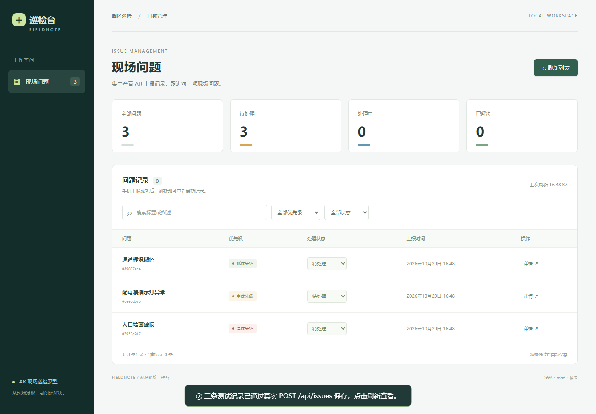

# Fieldnote · AR 现场巡检

Unity AR 放置标记并上报 → Go 保存 → React 查看并修改处理状态。

**交付状态：三端源码已实现；Go / React 的运行验证见 [验证记录](docs/VALIDATION.md)。Unity 尚未在编辑器编译或真机验收，手机演示视频未录制，因此尚未达到题目全部验收条件。** 本次环境没有 Unity 编辑器与可用 ARCore 真机；不能用普通 3D 或 API 测试代替真实 AR 演示。

用户已确认本次先完成源码、测试和上传，后续补充真机验收及手机视频。

[电脑端演示（约 3 分钟，无旁白）](demo/admin-demo.webm) · [真机录制脚本](demo/README.md)



## 目录与版本

| 目录 | 内容 | 版本 |
|---|---|---|
| `unity/` | Android AR 工程、场景、C#、一键配置菜单 | Unity 6.0 LTS `6000.0.62f1`，AR Foundation / ARCore `6.0.8` |
| `frontend/` | React + TypeScript 管理页 | React `19.1.1`，TypeScript `5.9.3`，Vite `7.3.7` |
| `backend/` | 无第三方依赖的 Go API 与 JSON 存储 | Go `1.24.13`（模块最低 1.24） |
| `scripts/` | 重启检查、电脑演示录制 | Python 3.11+；录制使用 Playwright |
| `demo/` | 电脑演示与真机录制说明 | [演示说明](demo/README.md) |
| `.github/workflows/` | Go、React、浏览器集成检查 | GitHub Actions |

前端需要 Node.js 22.12+（本地实际验证 Node.js 24.19.0）。Unity 版本基于[官方版本页](https://unity.com/releases/editor/whats-new/6000.0.62f1)，AR 安装步骤参考 [Google 官方指引](https://developers.google.com/ar/develop/unity-arf/getting-started-ar-foundation)。

## 启动 Go

在仓库根目录执行：

```sh
cd backend
go run . -addr :8080 -data ./data/issues.json
```

访问 `http://localhost:8080/health`，应得到 `{"status":"ok"}`。启动日志输出实际数据文件绝对路径。**始终使用同一数据路径，只允许一个服务进程写入该文件。** 数据文件与实际业务数据不提交到仓库；不要在演示前删除它。

## 启动 React

另开终端：

```sh
cd frontend
npm ci
npm run dev
```

打开 `http://localhost:5173`。开发服务器把 `/api` 转发给同一台电脑的 `127.0.0.1:8080`，因此无需额外处理浏览器跨域。手机直接访问同一 Go 服务的局域网地址。

生产构建可由 Go 一并提供，避免启动第二个服务器：

```sh
cd frontend
npm ci
npm run build
cd ../backend
go run . -addr :8080 -data ./data/issues.json -web ../frontend/dist
```

此时网页地址为 `http://localhost:8080`。跨域直连时，Go 的 `-origins` 可配置逗号分隔的来源白名单；默认允许 `http://localhost:5173,http://127.0.0.1:5173`。非白名单来源不会收到 CORS 允许头。

## Unity Android 真机配置

1. Unity Hub 安装 **6000.0.62f1**，同时安装 Android Build Support、SDK & NDK Tools、OpenJDK。添加并打开仓库中的 `unity/` 工程，等待包导入完成。使用内置渲染管线。
2. 在 `File > Build Profiles` 选择 Android 并切换平台。在 `Edit > Project Settings > XR Plug-in Management` 的 **Android** 页勾选 **ARCore**，保持 `Initialize XR on Startup` 开启。首次勾选让 Unity 创建平台配置资产。
3. 执行 `Inspection > Configure Android ARCore`。脚本设置 ARM64、IL2CPP、OpenGLES3、最低 API 24、Activity 入口、竖屏、允许局域网 HTTP 和 Legacy Input。若 Unity 提示重启，按提示重启后再执行一次该菜单。
4. 在 `XR Plug-in Management > Project Validation` 检查并修正 Android 配置。确认 `Player > Active Input Handling` 为 **Input Manager (Old)**。场景为 `Assets/Scenes/Inspection.unity`，已列入构建设置。
5. 手机必须是 [ARCore 支持设备](https://developers.google.com/ar/devices)，安装/更新 Google Play Services for AR，开启 USB 调试并连接电脑。使用 `Build And Run`；也可执行 `Inspection > Build Android APK` 生成 `unity/Builds/FieldnoteAR.apk` 后安装。首次允许相机权限。
6. 电脑与手机连接同一个可互通的局域网。电脑用 `ipconfig` 查询 Wi-Fi/以太网 IPv4，例如 `192.168.1.20`。确认手机浏览器能打开 `http://192.168.1.20:8080/health`；按需允许防火墙入站 TCP 8080，避免访客网络的设备隔离。
7. 在手机界面 **BACKEND URL** 输入 `http://192.168.1.20:8080`，不能填写 `localhost`。地址在提交时保存到本机，下次启动自动读取。界面提供的 IP 是示例，必须替换。
8. 缓慢移动手机，对准纹理清晰、光照良好的水平地面或桌面。检测到平面后出现绿色轮廓。点击轮廓内区域放置黄色立方体；再次点击会移动当前待提交标记。
9. 填写标题、可选描述、优先级，点击 **Submit issue**。成功提示返回 ID，保留已提交标记并按优先级着色；失败保留表单和待提交标记。提交期间禁用重复提交和放置。点击 UI 通过实际 UI raycast 排除，不会触发 AR 放置。

Unity 项目运行时创建 AR Session、XR Origin、AR Camera、水平 ARPlaneManager、ARRaycastManager 和 UI，无需手动拖拽引用。场景内只有启动脚本，**标记放置必须通过 AR 真实平面命中**，没有屏幕固定物体或普通 3D 模拟放置分支。

## API

JSON 字段三端一致，时间为 UTC RFC3339。创建请求不含后端生成字段。

| 方法 | 路径 | 成功响应 |
|---|---|---|
| GET | `/health` | `200 {"status":"ok"}` |
| POST | `/api/issues` | `201` 完整问题对象 |
| GET | `/api/issues` | `200` 问题数组，最新创建在前，空数组为 `[]` |
| PATCH | `/api/issues/{id}/status` | `200` 更新后的完整问题对象 |

创建请求（`Content-Type: application/json`）：

```json
{
  "title": "入口墙面破损",
  "description": "左侧墙体存在裂缝",
  "priority": "high",
  "position": { "x": 0.42, "y": 0.03, "z": 1.26 }
}
```

状态修改请求：`{"status":"in_progress"}`。允许 `open`、`in_progress`、`resolved` 自由切换。创建默认 `open`；优先级仅允许 `low`、`medium`、`high`。标题去除首尾空白后必填，最多 120 个字符；描述可省略，最多 2000 个字符；坐标三个分量必须明确提供且为有限数值。

后端用加密随机 128 位 ID，并生成 `createdAt`、`updatedAt`。参数错误 `400`，未知 ID `404`，非 JSON 内容类型 `415`，存储错误 `500`。错误格式：

```json
{"error":{"code":"INVALID_ARGUMENT","message":"priority must be low, medium, or high"}}
```

Go 用互斥锁串行处理写入：候选快照 → 同目录临时文件 → flush/sync → rename → 发布内存状态。保存失败不会返回成功，不会把失败修改留在内存。启动遇到损坏文件会报错退出，避免静默覆盖。

## 验证

```sh
cd backend
go test -v ./...
go vet ./...
go build -o ../work/inspection .
cd ..
python scripts/smoke.py work/inspection
cd frontend
npm ci
npm run build
npx playwright install chromium
npm run test:e2e
```

Windows 构建时把二进制命名为 `../work/inspection.exe`，重启检查参数也使用 `.exe`。`work/` 若不存在先创建。浏览器测试使用 8080 / 5173 端口，运行前停止占用端口的开发服务器；测试数据写入被忽略的 `work/e2e-issues.json`。Linux 可额外运行 `go test -race ./...`，CI 已配置。

## 可选 Docker

```sh
docker build -t fieldnote .
docker run --rm -p 8080:8080 -v fieldnote-data:/data fieldnote
```

网页与手机均使用这一个 Go 服务。挂载命名卷保留重启数据。Docker 配置已提供，本次环境未运行 Docker 验证。

## 已完成、待完成及已知限制

- 已实现：Unity 真实平面检测/放置逻辑、表单、UI 防误触、提交反馈；Go 校验/持久化/状态更新/CORS；React 列表、状态修改、错误恢复；筛选、搜索、详情、基础自动化测试。
- 已运行验证：以 [验证记录](docs/VALIDATION.md) 为准。电脑视频中的演示问题通过 API 创建，**并非手机上报证据**。
- 待完成：Unity 编辑器编译、Android 构建、ARCore 真机全流程、UI 防误触实测、手机 3～5 分钟视频。两端真实闭环在这些步骤通过前不能标为已验收。
- Unity 界面采用英文以避免默认字体中文缺字；中文标题/描述的数据传输和网页显示支持 UTF-8，手机输入中文的显示效果需另行导入合适的中文字体并验收。
- 坐标为 AR 当前会话世界坐标，单位米，保存的是命中点；不恢复跨会话物理位置，不同步网页状态到历史 AR 标记，长期 AR 漂移未处理。
- 原型无鉴权，面向可信局域网。HTTP 放行用于本地演示，公网使用前应增加 HTTPS、访问控制和备份。
- 网络超时可能发生“服务已保存但手机未收到响应”，没有自动重试/幂等键；手机提示先检查网页再手动重试，避免重复记录。
- JSON 存储只支持单进程写入，适合小型原型。没有分页、数据库迁移、跨设备定位或崩溃断电级事务保证。

AI 原始指令与实际修订记录见 [AI_LOG.md](AI_LOG.md)。核心代码说明见 [docs/CODE_GUIDE.md](docs/CODE_GUIDE.md)。
